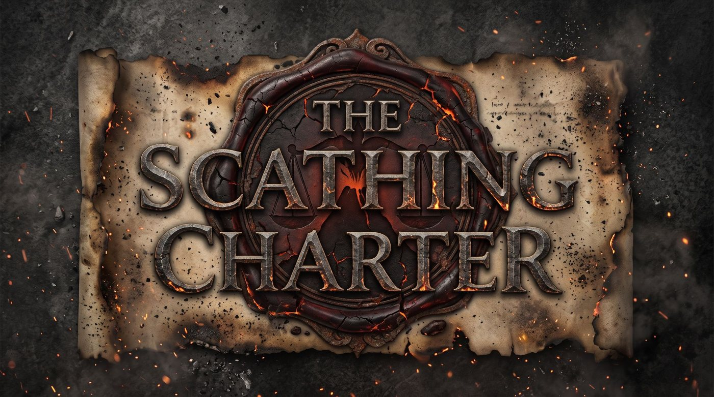

# The Scathing Charter

*A trading game set in the world of The Elder Scrolls, at the dawn of the Fourth Era.*

It is **1 Morning Star 4E 4** in Balmora. You owe the Camonna Tong 4,000 septims, you own one pack guar,
and you have three years. Buy low, sell high, pay off the debt and buy your way into the **Scathing Charter**,
through the last calm year, the **Red Year**, and the war that follows. Every place, good and event is drawn
from Elder Scrolls lore, with sources you can click.

## ▶ Play now

Welcome, outlander. There are two ways in, and both are free:

- **In your browser:** **[play The Scathing Charter online](https://ullafreehum.github.io/scathing-charter/)**.
  Nothing to install. It works on any computer with a modern browser, and your saves stay in that browser.
- **On Windows:** download the game from the **[v0.10.5 release](https://github.com/ullafreehum/scathing-charter/releases/tag/v0.10.5)**.
  Take **`ScathingCharter-Setup-0.10.5.exe`** to install it, or **`ScathingCharter-Portable-0.10.5.exe`** to run it
  from anywhere with no install. The game isn't signed, so Windows may say *"Windows protected your PC"*: click
  **More info**, then **Run anyway**.
- **On Android (test build):** the same release has **`ScathingCharter-0.10.5-Android-A26-debug.apk`**, made for the
  Samsung Galaxy A26 in landscape (other phones may work but aren't tested). It has no card duel. Android asks you to
  allow installs from unknown sources.

New here? Pick **Easy (Fair Terms)** for your first game, and read [Your first five minutes](#-your-first-five-minutes)
below. Want a taste first? **Card duel (practice)** on the title screen plays the magistrate's card hearing on its own.

Curious about the look of the world? Leaf through the art book, **[Art of the Red Year](docs/artbook/scathing-charter-artbook.pdf)** (PDF).

> Unofficial, non-commercial fan game. *The Elder Scrolls* is a trademark of ZeniMax Media / Bethesda
> Softworks. This project is not affiliated with or endorsed by them.

---

## 🕯️ Install on Windows

1. Open the **[latest release](https://github.com/ullafreehum/scathing-charter/releases/tag/v0.10.5)** (or [all releases](https://github.com/ullafreehum/scathing-charter/releases)) and download the newest
   **`ScathingCharter-Setup-<version>.exe`**. (Prefer no install? Take **`ScathingCharter-Portable-<version>.exe`**:
   one file that runs from anywhere, such as a USB stick.)
2. Run it. The game isn't signed, so the first time Windows may say *"Windows protected your PC"*: click
   **More info**, then **Run anyway**. You only see this once per download.
3. The installer puts **The Scathing Charter** in the Start menu and on the desktop. The game is fully
   self-contained: it doesn't need Node.js, Chrome or the internet.

The game opens **full screen**. **F11** or **Alt+Enter** switches between full screen and a window, **Esc**
leaves full screen when no in-game window is open, and **Ctrl+Plus / Ctrl+Minus / Ctrl+0** change the size
of the interface. It fits any screen from 1024×600 to 4K and ultrawide. Updating is the same: download the
new Setup and run it; your saves stay.

## 🎲 Your first five minutes

1. On the title screen, click **New game**.
2. **Pick a character card.** Each has a perk (+) and a drawback (−). *Hlaalu Factor's By-Blow* is a
   gentle start.
3. Keep or change your **Name**. The ↻ button suggests one that fits your race's naming customs.
4. Under **Difficulty**, choose **Easy (Fair Terms)** for your first game: a smaller debt and
   gentler interest.
5. Click **Start game**. Read the card that appears, then click **Continue**.

You're now in **Balmora**. The screen has three parts:
- **Top bar:** the date (with the two moons), your **Cash**, your **Debt** (it grows every day),
  **Bank** (deposits), **Cargo** (weight / capacity), health ♥, **Net worth** (your score) and your **Goal**, plus the
  **Codex** and **⚙ Settings** buttons.
- **Left panel:** where you are: its story, its laws, and the merchants here. Underlined words open the
  **Codex** (the in-game encyclopaedia).
- **Tabs:** **Market · Travel · Bank · Tavern · Shop & Temple · Journal**.

A good first loop:
1. **Tavern → Buy a round & hear rumours.** It's the New Life Festival, so rumours are free tonight. Rumours give price
   tips and warnings.
2. **Market.** A green **▼** next to a price means it's cheap here; a red **▲** means it's expensive.
   Pick an **Amount** (1, 5, 10, 25 or Max) at the top, then press **Buy** on a cheap good.
   - Avoid goods marked **CONTRABAND** at first: customs can seize them.
3. **Travel.** The map opens zoomed on the towns you can reach, with travel days on each route. Click a
   town (or press its number, 1–9) to open its card: every way there, fares, danger, warnings and, once
   you have visited it, what your cargo would sell for there. Press **Go**. Each trip costs
   days and a fare. On the road you may meet trouble; read the card and choose.
4. You arrive on the **Market** tab: **Sell** what you carried if it's worth more here (each good you
   carry shows its profit per unit, and **Sell all at a profit** does it in one click).
5. When you have a few hundred spare septims, go back to Balmora's **Bank** tab and **Pay** some of the
   debt. The longer you leave it, the more the Camonna Tong's collectors come looking for you.

> 💡 The strip under the top bar suggests your next step (debt deadline, contracts, closed markets).
> Rumours and achievements pop up briefly in the bottom-left corner; click to dismiss.
>
> Read the rumours, and keep an eye on the ash falling on screen. History in this game happens on
> real dates, and it does not care where you keep your money.

---

## ▶️ Playing again later

Start **The Scathing Charter** from the Start menu or the desktop. On the title screen, click **Continue**
to pick up where you left off.

## 💾 Your saves

- The game **saves automatically** after every action, on your computer (in `%APPDATA%\The Scathing Charter`).
- **☰ menu → Save to slot 1/2/3** keeps extra copies; they appear on the title screen.
- **☰ menu → Export save file** downloads a `scathing-charter-….json` file (older `.ashfall.json` backups still import). Keep it as a backup, or move your game to
  another computer with **Import save file…** on the title screen.
- Saves from playing in a web browser (versions before 0.10) don't move over by themselves: in the browser,
  use **Export save file**, then **Import save file…** in the desktop game.

## 🛠️ If something goes wrong

| What you see | What to do |
|---|---|
| *"Windows protected your PC"* | The game isn't signed. Click **More info**, then **Run anyway**. |
| The game is stuck in a window, or stuck full screen | Press **F11** (or **Alt+Enter**), or use **⚙ Settings → Full screen**. |
| Everything is too big or too small | **Ctrl+Plus / Ctrl+Minus**, or **⚙ Settings → Text and UI size**. **Ctrl+0** resets it. |
| My **Continue** button disappeared | Use **Import save file…** with an exported backup. |
| Text is hard to read, or the falling ash is distracting | Open **⚙ Settings** (top bar or title screen): 5 colour themes, 4 fonts, text and UI size, ash and animations on/off, sound and volume. |

## 🍎 Mac or 🐧 Linux

There is no desktop build for these yet. You can run the game from its source: install Node.js 20+ from
https://nodejs.org, download this repository (green **`<> Code`** button → **Download ZIP**), then in a
terminal in that folder run `npm install` and `npm start`.

---

## 📖 How to play (reference)

- **Market:** buy where a good is cheap (▼) and sell where it is expensive (▲). One **Amount** setting
  drives every Buy/Sell button and is capped by your cash and cargo space. **Best seen elsewhere** is
  your own price book: the highest price you saw in another town, and how long ago. Filters, sorting
  and **Sell all at a profit** are above the table. Big trades move the price against you.
  - **Contraband** sells only to fences (merchants marked *fence*), and customs may search you on arrival.
  - **EEC** goods (ebony, glass, stalhrim) sell openly only to East Empire Company factors.
- **Travel:** every route costs days, a fare (plus freight for heavy loads) and some danger.
  - **Map:** *My routes · Vvardenfell · Morrowind · All Tamriel* views, mouse-wheel or **+/−** zoom,
    drag to move. Towns you can reach are bright, with the days marked on each route.
  - **Town card:** click any town for every way there, fares, danger, price outlook and warnings
    (contraband there, market closed on arrival, siege, missed contract deadline).
  - **Far towns:** the card shows the fastest chain of journeys. **Plan this route** keeps it on the map
    and in the hint strip, and **Next stop** takes the next leg.
  - **Markers** (toggle under the map): contract destinations (C), where you can pay the debt (D), banks
    (B), healing (+), and towns where your cargo sells higher (↑ +amount). If you're
  broke, you can **work your passage** instead: free, but slower.
- **Goal:** pay off the Camonna Tong, then buy the Scathing Charter before the end of 4E 6 to win. If your
  debt passes six times the note, the Tong puts its mark on you and the game ends. Otherwise, at the end you
  retire, ranked by net worth. The Bank tab shows your progress.
- **Bank:** each bank city has a strongbox. Money left there stays in that city, earns a little interest and
  is safe from robbers, but history can destroy a vault.
- **Timeline:** the thin bar under the top bar is the whole campaign: how far you are, what has happened (gold),
  and what the rumours say is coming (hollow). Hover it for details.
- **Markets remember you:** selling a lot of one good floods that town's market for a few weeks
  (the Market shows *Flooded · 12d*). Spread your trade around.
- **Smuggling** draws the Legion's attention: the more you smuggle, the more often customs search you.
  Lying low or bribing customs helps.
- **The Scathing Charter:** after the Red Year, once your debt is paid, buy trade rights to rebuild the
  Vivec region in Mournhold, Narsis or Balmora (Bank tab): a relief licence, a warehouse at Narsis, then the
  full charter, which wins the game (in the Long Chronicle it pays a share every 30 days). Renew it when the council changes hands.
- **Road events:** each choice shows its real chance of success.
- **Tavern:** rumours (tips, omens, and historians arguing), contracts, hired porters (+12 stone) and
  sellswords, day labour, and rest. Each round also adds an old tale to your Codex.
- **Shop & Temple:** bigger carts and holds, weapons and armour, scrolls (Chameleon, Almsivi and
  Divine Intervention), and healing.
- **Score:** your **Net worth** = cash + deposits + cargo value − debt. At the end you earn a
  title, plus conduct titles and achievements.
- **Long Chronicle:** finish the Red Year alive and in profit to unlock it. History carries on to the
  coronation of Titus Mede I, a week per day of travel.
- **Keyboard:**
  - Tabs: `m` Market, `t` Travel, `b` Bank, `v` Tavern, `s` Shop & Temple, `j` Journal.
  - On the Travel tab, `1`–`9` open a destination's card and `Enter` goes; `Esc` closes the card.
  - `c` opens the Codex; `Esc` closes it (and Settings).
- **Settings (⚙):** five readable colour themes named after Vvardenfell regions (Ashlands, Bitter Coast,
  Azura's Coast, Ascadian Isles, West Gash), four fonts, text size, falling ash, animations, sound and
  volume. Saved on your computer.
- **Lore badges** (in the Codex): *Unverified*, *Historians disagree*, *Extrapolation* and *Invented for
  this game* tell you how sure the lore is. **Codex → Historians disagree** has the arguments, with
  sources.

## 🧑‍💻 For developers

| Command | What it does |
|---|---|
| `npm start` / `npm run dev` | Dev server (`start` also opens the browser) |
| `npm run desktop` | Build and open the desktop app (Electron) |
| `npm run package:win` | Build the Windows installer and portable .exe into `release/electron/` (run on Windows; CI does this for releases) |
| `npm test` | Unit tests: engine, determinism/replay, calendar, saves, data integrity |
| `npm run test:e2e` | Browser tests: smoke, UI behaviour, critical-moment scenarios, random-click crash test. Run `npx playwright install chromium` once first. |
| `npm run diagnose -- 4` | Engine stress test: random play across all backgrounds and difficulties with invariant checks |
| `npm run balance -- 24` | Balance diagnostics: six player-type bots, difficulty sweep, economy scan |
| `npm run lint` / `npm run typecheck` | ESLint / TypeScript |

- [`CLAUDE.md`](CLAUDE.md): architecture and conventions.
- [`docs/GAME_DESIGN.md`](docs/GAME_DESIGN.md): design and balance results.
- [`docs/LORE_BIBLE.md`](docs/LORE_BIBLE.md): every lore fact with its source, the 24 recorded
  disputes, and everything invented for this game.
